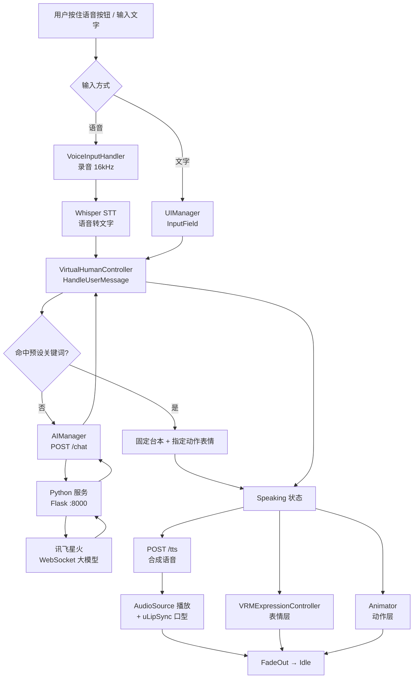

# 虚拟人对话系统 · Virtual Human

> 本科毕业设计：基于 Unity + VRM 的实时交互式虚拟人，打通「语音输入 → 语音识别 → 大模型对话 → 语音合成 → 表情 / 口型 / 肢体动作」的完整闭环。


---

## 简介

用户按住说话或输入文字，系统先用 Whisper 做中文语音识别，再把文本交给讯飞星火大模型生成回复，接着由本地 TTS 服务合成语音并播放；在开口说话的同时，虚拟人会根据回复内容自动切换表情、驱动口型、配合肢体动作（点头、摇头、挥手、介绍、惊讶、跳舞等）。

虚拟人的全部行为由一个**五态状态机**统一调度，表情与口型采用**双通道权重混合**分别渲染，因此「边说话边做表情边做动作」可以并行而不互相打架。

---

## 功能特性

- **双模输入**：长按语音（最长 10 秒，上滑取消发送）+ 文字输入（回车或按钮发送）
- **中文语音识别**：Whisper（ggml-small）本地推理，16 kHz 单声道，只识别实际录音段
- **多轮对话**：按 `session_id` 维护上下文，自动裁剪历史长度以控制 Token 消耗
- **情感表情**：关键词分析出 5 类情绪（中性 / 开心 / 悲伤 / 惊讶 / 生气），平滑淡入淡出
- **实时口型同步**：uLipSync 提取音素（A / I / U / E / O），映射为 VRM 的 `aa` 混合权重
- **肢体动作**：8 种动作经 Animator 整型参数 `ActionType` 切换，与说话并行播放
- **预设指令**：「跳个舞」「打个招呼」「介绍一下自己」等命中关键词时跳过 AI，直接走固定台本，演示更稳定
- **聊天 UI**：气泡式布局、自适应高度、自动滚动到底部、录音音浪动画与加载状态提示

---

## 系统架构



### 虚拟人行为状态机

```
Idle ──用户发消息──> Thinking ──收到回复──> ActionSelection ──> Speaking ──> FadeOut ──> Idle
```

| 状态 | 虚拟人在做什么 |
| --- | --- |
| `Idle` | 中立表情待机，可随时接受输入 |
| `Thinking` | 等待 AI 返回，表情轻微波动（正弦扰动），可选播放思考动作 |
| `ActionSelection` | 分析回复文本的情感与语义，决定表情与肢体动作 |
| `Speaking` | 表情 + 口型 + 动作三者并行，等待音频播放完毕 |
| `FadeOut` | 关闭口型层、停止动作、表情平滑淡出回中性 |

---

## 技术栈

| 模块 | 方案 |
| --- | --- |
| 引擎 | Unity 2022.3.62f2（内置渲染管线），TextMeshPro |
| 虚拟人模型 | VRM 1.0 + [UniVRM10](https://github.com/vrm-c/UniVRM)（`com.vrmc.vrm`、`com.vrmc.gltf`，随仓库内嵌） |
| 口型同步 | [uLipSync](https://github.com/hecomi/uLipSync)（内嵌于 `Packages/uLipSync`） |
| 语音识别 | [whisper.unity](https://github.com/Macoron/whisper.unity)（whisper.cpp 封装，ggml-small 模型） |
| 大模型 | 讯飞星火（WebSocket，HMAC-SHA256 鉴权） |
| 语音合成 | Edge TTS（首选）/ gTTS / pyttsx3（降级备选） |
| 后端 | Python 3.9+ · Flask · websocket-client · pydub · FFmpeg |

---

## 快速开始

### 1. 环境要求

- **Unity** 2022.3.62f2（或同系列 2022.3 LTS）
- **Python** 3.9 及以上
- **FFmpeg**（Edge TTS 生成的 MP3 需要转成 WAV，必装）
- 可访问互联网（调用讯飞星火 API）

### 2. 克隆仓库

```bash
git clone https://github.com/futtco/Virtual-Human-repository.git
cd Virtual-Human-repository
```

### 3. 下载 Whisper 模型（必须）

模型文件超过 100 MB，未纳入版本管理（`*.bin` 已在 `.gitignore` 中）。首次使用需手动下载：

1. 下载 `ggml-small.bin`
   - [Hugging Face · whisper.cpp](https://huggingface.co/ggerganov/whisper.cpp/tree/main)
   - 或 [whisper.cpp Releases](https://github.com/ggerganov/whisper.cpp/tree/master/models)
2. 放到以下路径：

```
Assets/StreamingAssets/whisper/models/ggml-small.bin
```

### 4. 安装后端依赖

```bash
pip install -r requirements.txt
pip install edge-tts pydub gTTS requests
```

FFmpeg 安装（Windows 任选其一）：

```bash
choco install ffmpeg          # Chocolatey
winget install FFmpeg         # Winget
```

安装后确认 `ffmpeg -version` 能正常输出版本信息。

### 5. 启动后端服务

```bash
python xunfei_tts_service.py
```

看到 `Running on http://127.0.0.1:8000` 即启动成功。**此窗口需保持开启**，否则虚拟人无法对话与发声。

自检：

```bash
curl http://127.0.0.1:8000/health
# {"status":"ok","ai_engine":"XunfeiSparkEngine","tts_engine":"EdgeTTSEngine",...}
```

### 6. 运行 Unity 场景

1. 用 Unity Hub 打开项目根目录，等待资源导入完成
2. 打开场景 `Assets/Scenes/VirtualHuman.unity`
3. 点击 Play
4. 按住左下方的语音按钮说话（或切到键盘输入模式打字发送）
5. 虚拟人会在聊天框回复，并同步开口说话、做表情与动作

---

## 后端接口

服务默认监听 `http://127.0.0.1:8000`。

| 方法 | 路径 | 说明 |
| --- | --- | --- |
| `POST` | `/chat` | 对话。入参 `{"message": "...", "session_id": "default"}`，返回 `{"success": true, "response": "..."}` |
| `POST` | `/tts` | 语音合成。入参 `{"text": "..."}`，返回 `{"success": true, "audio_data": "<base64>", "format": "wav"}` |
| `POST` | `/clear_history` | 清空指定会话的对话历史。入参 `{"session_id": "default"}` |
| `GET` | `/health` | 健康检查，返回当前 AI / TTS 引擎状态 |

`/tts` 会对长文本按 30 字分段合成再拼接，单段失败自动重试（最多 3 次）；Edge TTS 不可用时降级到 gTTS 或 pyttsx3。

---

## 目录结构

```
Virtual-Human-repository/
├── Assets/
│   ├── Scenes/
│   │   └── VirtualHuman.unity          # 主场景
│   ├── Scripts/
│   │   ├── VirtualHumanController.cs   # 虚拟人主控：状态机 / 动作选择 / TTS 播放
│   │   ├── VRMExpressionController.cs  # 表情层 + 口型层的双通道权重混合
│   │   ├── LipSyncManager.cs           # uLipSync 播放控制
│   │   ├── AIManager.cs                # 调用本地 /chat 接口，管理会话
│   │   ├── VoiceInputHandler.cs        # 长按录音、上滑取消、调用 Whisper
│   │   ├── ChatManager.cs              # 气泡消息布局与自动滚动
│   │   ├── UIManager.cs                # 语音/文字模式切换与发送
│   │   ├── VoiceWaveAnimation.cs       # 录音音浪动画
│   │   └── CameraController.cs         # 视角控制
│   ├── Resources/
│   │   ├── Animation/                  # 动作 FBX + avatarController 状态机
│   │   ├── Prefab/                     # VRM 模型、UI 画布、消息气泡
│   │   └── Image/                      # UI 图标
│   └── StreamingAssets/whisper/models/ # Whisper 模型目录（需自行放置 ggml-small.bin）
├── Packages/                           # UniVRM10 / uLipSync 内嵌包
├── xunfei_tts_service.py               # Python 后端：星火对话 + TTS
├── requirements.txt
└── *.md                                # 设计文档、论文大纲、环境指南
```

---

## 关键实现说明

### 表情与口型：双通道混合

`VRMExpressionController` 把 VRM 的表情系统拆成两层分别渲染，避免互相覆盖：

- **情感层**：`neutral / happy / sad / surprised / angry`，混合速度 2.0，切换时平滑过渡；表情显示 2 秒后进入 1 秒淡出，随后自动回中性
- **口型层**：只占用 `aa` 一个通道，混合速度 8.0（比情感层快得多，跟得上语速），仅在 `isMouthActive` 为真时响应 uLipSync

口型权重由音素决定，可在 Inspector 中调：A 1.0 / I 0.3 / U 0.6 / E 0.5 / O 0.8。

### 动作：整型参数驱动

肢体动作通过 Animator 的 `ActionType` 参数切换，数值与动作一一对应：

| 值 | 0 | 1 | 2 | 3 | 4 | 5 | 6 | 7 |
| --- | --- | --- | --- | --- | --- | --- | --- | --- |
| 动作 | 无 | 点头 | 摇头 | 挥手 | 介绍 | 惊讶 | 舞蹈 | 思考 |

动作由回复文本决定：出现「你好 / 欢迎」→ 挥手，出现「抱歉 / 无法」→ 摇头，出现「介绍 / 首先」→ 介绍手势，情感为惊讶 → 惊讶动作，依此类推。

### 情感分析

纯本地关键词匹配，按优先级依次判断：悲伤 → 惊讶 → 开心 → 生气 → 默认中性。整个判定在客户端完成，不额外消耗大模型调用。

---

## 可调参数

**Unity 侧（Inspector）**

| 位置 | 参数 | 作用 |
| --- | --- | --- |
| `AIManager` | `Local Service Url` | 后端地址，默认 `http://127.0.0.1:8000` |
| `AIManager` | `Session Id` | 对话会话标识，改它相当于换一个新对话 |
| `VirtualHumanController` | `Tts Service Url` | TTS 地址，默认 `http://127.0.0.1:8000/tts` |
| `VirtualHumanController` | `Post Speak Fade Duration` | 说完后淡出时长，默认 1 秒 |
| `VRMExpressionController` | `Emotion Blend Speed` / `Mouth Blend Speed` | 表情/口型切换速度 |
| `VRMExpressionController` | `Phoneme X Weight` | 各元音对应的口型开度 |

**Python 侧**

- 端口：`xunfei_tts_service.py` 末尾 `app.run(host='127.0.0.1', port=8000)`，改动后需同步 Unity 里的服务地址
- 人设：`XunfeiSparkEngine.get_response` 里的 `system` 提示词（当前限制「每次回复不超过 25 字」以适配语音交互）
- 历史长度：超过 10 条时自动裁剪，保留 system 提示 + 最近 9 条

---

## 常见问题

| 现象 | 排查方向 |
| --- | --- |
| 识别不出声音 / 没有麦克风 | Windows 隐私设置里允许 Unity 使用麦克风；确认 `Microphone.devices` 非空 |
| 文字出来但虚拟人不说话 | 后端服务没启动，或 8000 端口被占用；先 `curl /health` 自检 |
| 有声音但没口型 | `LipSyncManager` 的 `uLipSync` 组件未在 Inspector 赋值，或 AudioSource 未挂上 |
| 表情不切换 / 表情卡住 | VRM 模型缺少对应 Expression，检查模型的 BlendShape 命名 |
| 动作不播放 | Animator 里 `ActionType` 参数类型需为 Int，且已配置对应 Transition |
| 音频无声 | 检查 FFmpeg 是否安装（Edge TTS 依赖它转码）、Unity 与系统音量 |
| 讯飞报签名错误 | 校对 APPID / APIKey / APISecret，确认网络能访问 `wss://spark-api.xf-yun.com` |

更多细节见 [WINDOWS_SETUP_GUIDE.md](WINDOWS_SETUP_GUIDE.md)（含 9 个典型故障的完整排查步骤）与 [TROUBLESHOOTING.md](TROUBLESHOOTING.md)。

---

## 文档索引

| 文档 | 内容 |
| --- | --- |
| [ARCHITECTURE.md](ARCHITECTURE.md) | 数据流、组件通信、接口格式与性能指标 |
| [LIPSYNC_AND_EXPRESSION_SETUP.md](LIPSYNC_AND_EXPRESSION_SETUP.md) | 口型与表情的场景配置、参数说明、调试方法 |
| [XUNFEI_SERVICE_GUIDE.md](XUNFEI_SERVICE_GUIDE.md) | 讯飞星火服务的接入与鉴权说明 |
| [WINDOWS_SETUP_GUIDE.md](WINDOWS_SETUP_GUIDE.md) | Windows 环境配置与故障排查 |
| [TROUBLESHOOTING.md](TROUBLESHOOTING.md) | 问题速查 |
| [IMPLEMENTATION_SUMMARY.md](IMPLEMENTATION_SUMMARY.md) | 早期实现记录（OpenAI 方案阶段） |

> 说明：`ARCHITECTURE.md` 与 `IMPLEMENTATION_SUMMARY.md` 记录的是项目中期采用 OpenAI GPT-4o Mini 的方案，当前代码已切换为本地 Python 服务 + 讯飞星火，阅读时请注意区分。

---

## 致谢

本项目基于以下开源工作完成：[UniVRM](https://github.com/vrm-c/UniVRM)、[uLipSync](https://github.com/hecomi/uLipSync)、[whisper.unity](https://github.com/Macoron/whisper.unity)、[whisper.cpp](https://github.com/ggerganov/whisper.cpp)、[edge-tts](https://github.com/rany2/edge-tts)。VRM 角色模型来自 VRoid Hub 公开素材，仅供学习与答辩演示使用。

---

<p align="center"><i>毕业设计项目 · 仅供学习交流</i></p>
